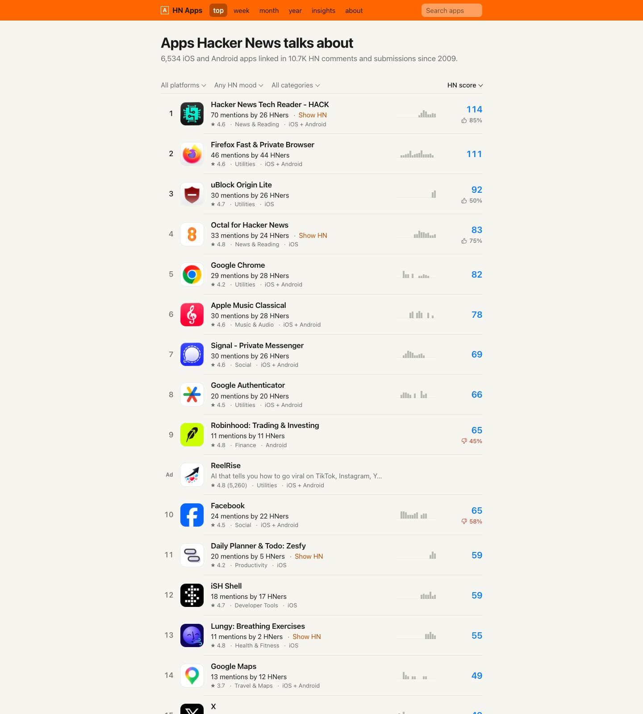
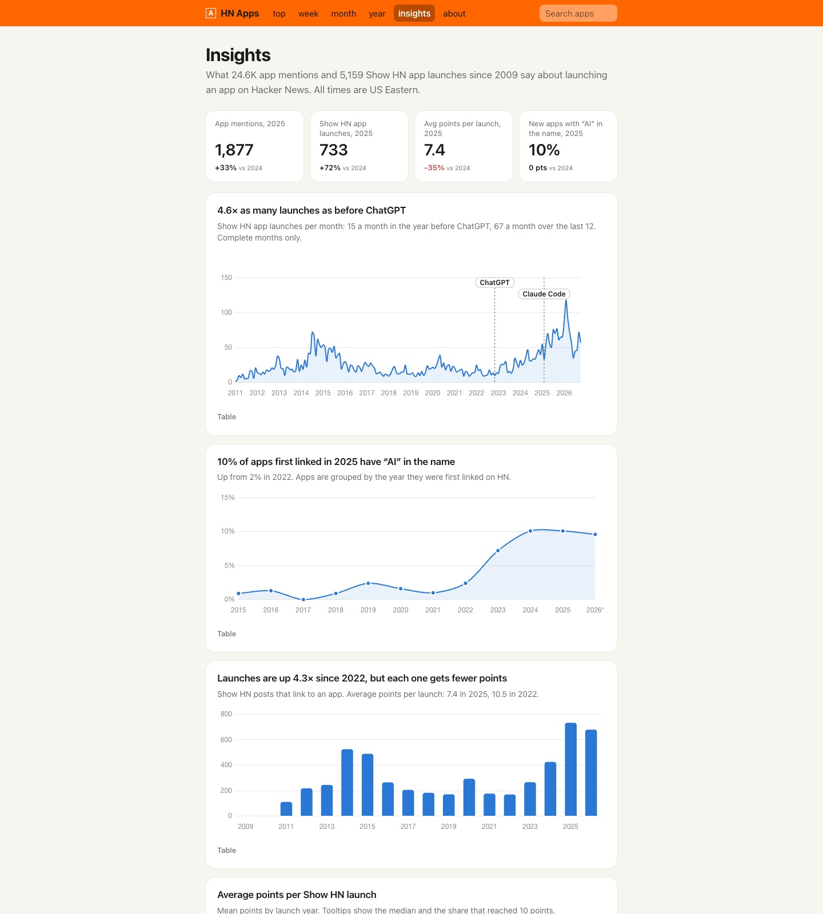

<p align="center">
  
</p>

<h1 align="center">HN Apps</h1>

<p align="center">An app store where the only way in is to get mentioned on Hacker News.<br>
Every iOS and Android app anyone has linked in an HN comment or submission since 2009, ranked by how much HN talked about it.</p>

<p align="center">
  <a href="https://vladimirsvsv77.github.io/HN-Apps/">the site</a> ·
  <a href="docs/data/DATA.md">the dataset</a> ·
  <a href="https://vladimirsvsv77.github.io/HN-Apps/#/insights">insights</a>
</p>

---

**6,552 apps · 24,626 mentions · 2008 to today · a sentiment label on every mention of a listed app · rebuilt weekly**

HN has been recommending, launching and complaining about mobile apps for seventeen years, one link at a time. This site collects every one of those links, resolves it to its store page, and ranks the result. Think App Store charts, but the only vote that counts is an HN comment.

## What you get

- **Top apps**, all time or by week, month and year, so you can see what HN linked in 2014 or last week.
- **An HN score** that rewards many people over one viral post: a comment is 1, a submission is 1 + log2(points + 1) + log2(comments + 1), and each distinct HN user adds 1. A developer's own posts only count for the reaction they got.
- **HN mood** per app: every mention is labeled positive, neutral or negative, the developer's own posts are set aside, and apps where three or more people take a side get a thumb. Facebook, Robinhood and Threads are at the bottom. The HN reader apps and uBlock Origin Lite are near the top.
- **A sparkline per row**, one bar per year, so you can tell a 2024 spike from a decade-long habit.
- **Insights**: what 5,167 Show HN app launches say about launching on HN.
- **A weekly RSS feed** of the top ten apps HN linked that week: [feed.xml](https://vladimirsvsv77.github.io/HN-Apps/feed.xml).

<p align="center">
  
</p>

## Things the data says

- Show HN app launches run at **4.6x the pace they did before ChatGPT**, and each one earns fewer points: 7.4 on average in 2025, 10.5 in 2022.
- **10% of apps first linked in 2025 have "AI" in the name**, up from 2% in 2022.
- 9% of Show HN app launches reach 10 points, and launch timing matters less than people think. The day of week does make a difference (p = 0.03): Sunday launches reach 10 points 13% of the time, against 9% otherwise. Month (p = 0.33) and hour (p = 0.91) differences are within chance. <!--timing-->
- No store category clearly does better: Travel & Maps looks best at 13% of 55 launches, but the differences are within chance (p = 0.36). <!--category-->
- 46% of the mentions of apps still on a store are the developer's own post.

These come from `docs/data/stats.json` and are recomputed on every rebuild, so the Insights page will drift from this README. Trust the page.

## The dataset

`docs/data/mentions.jsonl` has every mention: item id, author, date, text, the thread it sits in, the store links, and the sentiment label. 24,626 rows, 4.9 MB gzipped, CC BY 4.0. Per-app files and the Insights aggregates are next to it. [DATA.md](docs/data/DATA.md) has the schema and the labeling method.

```sh
curl -sL https://vladimirsvsv77.github.io/HN-Apps/data/mentions.jsonl.gz | gunzip | head -1 | jq
```

## How it is built

Plain Python scripts, no framework, no database, no keys. A weekly rebuild refetches the HN links, refreshes store details that are more than a week old and thread numbers that are still settling, and only labels mentions it hasn't seen before.

```sh
python3 -m venv .venv && .venv/bin/pip install requests google-play-scraper
.venv/bin/python pipeline/fetch_clickhouse.py   # HN dump through Aug 2023 (play.clickhouse.com)
.venv/bin/python pipeline/fetch_algolia.py      # everything after (Algolia HN API)
.venv/bin/python pipeline/extract_links.py      # -> data/mentions.jsonl
.venv/bin/python pipeline/fetch_threads.py      # thread points and comment counts (HN Firebase API)
.venv/bin/python pipeline/extract_links.py      # again, to apply them
.venv/bin/python pipeline/enrich_apps.py        # store metadata
.venv/bin/python pipeline/build_site.py         # -> docs/data/*, docs/feed.xml, preview tags
.venv/bin/python pipeline/sentiment.py          # labels for new mentions (uses a local LLM CLI)
.venv/bin/python pipeline/build_site.py         # again, with the labels
.venv/bin/python pipeline/export_dataset.py     # -> docs/data/mentions.jsonl
.venv/bin/python pipeline/make_og.py            # -> docs/og.png, the link-preview image
.venv/bin/python pipeline/update_docs.py         # refresh the numbers in README.md and DATA.md
```

Set `SITE_URL` when running `build_site.py` if the site lives somewhere other than `https://vladimirsvsv77.github.io/HN-Apps`. Wrong iOS/Android merges can be fixed by hand in `pipeline/overrides.json`.

The site is the `docs/` folder: three static files and the JSON they read. Serve it with anything:

```sh
python3 -m http.server 8787 --directory docs
```

Store names, icons and ratings come from the App Store and Google Play. The site hotlinks icons and screenshots. The preview images in `media/` and `docs/og.png` are screenshots of the site, so they show some app icons.

## Sponsorship

One row in lists of ten or more apps is a paid slot, marked "Ad", so the rankings stay honest. It is the only place on the site that is not data.

## Credits

Inspired by [HackerTube](https://hackertube.org) and [HackerBooks](https://hackerbooks.org). Built with Claude Code.

Code is MIT. The thumbs icons are from [Lucide](https://lucide.dev) (ISC). Labels and derived tables are CC BY 4.0. HN comment text belongs to its authors, and store text and artwork belong to the developers and the stores.
